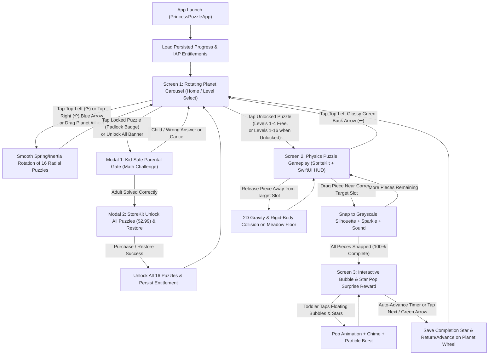

# SCREEN FLOW — Princess Puzzle for Girls and Toddlers

## 1. Navigation Architecture Overview

The application is designed for toddlers and young girls aged **1 to 6**. Navigation is intentionally immediate, text-minimal, and icon-driven, matching the reference application (`com.thasmobi.physicsPuzzle05`):

- **Zero Splash-Screen Clutter**: Launches directly into the interactive **Rotating Planet Carousel Scene** so a 1–6 year old can start playing within one tap.
- **Single-Tap Entry & Exit**: Tapping any unlocked character around the planet wheel launches the **Physics Puzzle Gameplay Scene**; tapping the top-left glossy green back arrow returns to the wheel.
- **Kid-Safe Parental Gate**: Tapping a locked puzzle (Levels 5–16 when not yet unlocked) opens a simple adult-verification Parental Gate before presenting the StoreKit **"Unlock all puzzles ($2.99)"** sheet or Restore Purchases action.

---

## 2. State & Screen Flow Diagram

---

## 3. Detailed Screen Transitions & Behaviors

### 3.1 Screen 1 → Screen 2 (Planet Wheel to Puzzle Gameplay)
1. **Trigger**: User taps either the currently centered 12-o'clock puzzle character or any unlocked puzzle character around the planet wheel.
2. **Visual Transition**:
   - The central planet wheel scales down slightly and fades out (`0.35s` ease-in-out) while the meadow background remains seamlessly in place and dims by `18%`.
   - The grayscale silhouette of the selected puzzle fades in at the upper-center target area.
   - The colored anatomical puzzle pieces spawn slightly above the river and drop under SpriteKit gravity onto the meadow floor with gentle bounce and tilt.

### 3.2 Screen 2 → Screen 3 (Puzzle Completion to Interactive Surprise Reward)
1. **Trigger**: The last remaining puzzle piece snaps into its target slot on the grayscale template.
2. **Visual Transition**:
   - The completed full-color illustration performs a celebration bounce (`1.0 -> 1.12 -> 1.0` scale) with a golden star burst.
   - Cheerful victory fanfare plays.
   - Colorful translucent soap bubbles, stars, and royal crowns float upward from the bottom of the screen across the meadow.
   - The toddler can tap as many bubbles as they want to pop them (`6–10 seconds` interactive celebration window, or tap the Next/Back button at any time).

### 3.3 Screen 3 → Screen 1 (Completion Return & Wheel Auto-Rotation)
1. **Trigger**: Celebration completes or user taps the top-left green back arrow / next button.
2. **Visual Transition**:
   - Returns to the Planet Carousel Wheel.
   - The newly completed puzzle displays its completion star/crown badge.
   - The planet wheel smoothly rotates one step (`22.5°` for 16 levels) to bring the next puzzle to the 12-o'clock top indicator line.

### 3.4 Screen 1 → Parental Gate → StoreKit Sheet
1. **Trigger**: Tapping a locked puzzle (Levels 5–16 prior to purchase) or the lock icon.
2. **Parental Gate**:
   - Displays a child-proof arithmetic challenge (e.g., `"Parents Only: What is 14 + 23?"` with three multiple-choice buttons) so toddlers aged 1–6 cannot accidentally trigger system purchase dialogs.
3. **StoreKit Purchase / Restore Modal**:
   - Once the adult passes the gate, displays the `"Unlock all puzzles"` (`$2.99`) purchase option and `"Restore Purchases"` button powered by native StoreKit 2.
