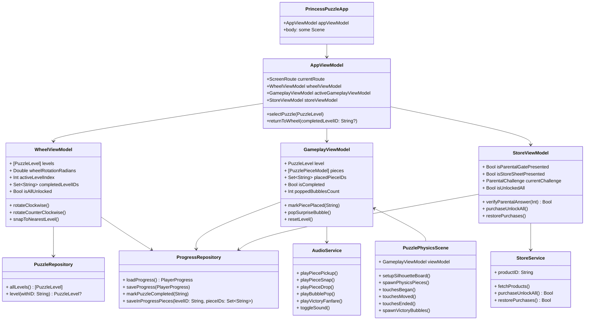

# TECHNICAL ARCHITECTURE — Princess Puzzle for Girls and Toddlers

## 1. Technology Stack Compliance (100% Apple Native)

- **Programming Language**: 100% **Swift 5.10 / Swift 6 Compatible**.
- **UI Framework**: **SwiftUI** + **UIKit** bridge where needed.
- **2D Game & Physics Engine**: **SpriteKit** (`SKScene`, `SKSpriteNode`, `SKPhysicsBody`, `SKPhysicsContactDelegate`, `SKAction`, `SKEmitterNode`).
- **Graphics & Vector Illustration**: **CoreGraphics** (`UIGraphicsImageRenderer`, `CGContext`, `UIBezierPath`) + **CoreAnimation**.
- **Audio Engine**: **AVFoundation** (`AVAudioPlayer`, `AVAudioSession`, procedural PCM WAV synthesizer).
- **In-App Purchase**: **StoreKit 2** (`Product`, `Transaction`, `AppStore.sync()`).
- **Unit & Integration Testing**: **XCTest** (`PrincessPuzzleTests`).
- **Zero Forbidden Dependencies**: No Flutter, No React Native, No WebView, No Unity, No JavaScript/HTML/CSS, No third-party CocoaPods/SPM runtime dependencies.

---

## 2. Clean MVVM + Repository + Service Architecture



---

## 3. Directory & File Structure

```text
PrincessPuzzle/
├── PrincessPuzzle.xcodeproj/
│   ├── project.pbxproj
│   └── project.xcworkspace/
├── project.yml
├── PrincessPuzzle/
│   ├── App/
│   │   ├── PrincessPuzzleApp.swift
│   │   └── RootContainerView.swift
│   ├── Models/
│   │   ├── PuzzleLevel.swift
│   │   ├── PuzzlePieceModel.swift
│   │   ├── PlayerProgress.swift
│   │   └── ParentalChallenge.swift
│   ├── Views/
│   │   ├── PlanetWheelScreenView.swift
│   │   ├── PuzzleGameplayScreenView.swift
│   │   └── SurpriseCelebrationOverlayView.swift
│   ├── ViewModels/
│   │   ├── AppViewModel.swift
│   │   ├── WheelViewModel.swift
│   │   ├── GameplayViewModel.swift
│   │   └── StoreViewModel.swift
│   ├── Services/
│   │   ├── AudioService.swift
│   │   └── StoreService.swift
│   ├── Repositories/
│   │   ├── PuzzleRepository.swift
│   │   └── ProgressRepository.swift
│   ├── Game/
│   │   ├── PuzzlePhysicsScene.swift
│   │   ├── PuzzlePieceSpriteNode.swift
│   │   └── SurpriseBubbleNode.swift
│   ├── Components/
│   │   ├── MeadowBackgroundView.swift
│   │   ├── RotatingPlanetWheelView.swift
│   │   ├── CurvedBlueArrowButton.swift
│   │   ├── GlossyGreenBackButton.swift
│   │   ├── PuzzleIllustrationRenderer.swift
│   │   └── ParentalGateModalView.swift
│   ├── Utilities/
│   │   ├── ThemeColors.swift
│   │   └── GeometryHelpers.swift
│   └── Resources/
│       ├── Assets.xcassets/
│       │   ├── Contents.json
│       │   ├── AppIcon.appiconset/
│       │   └── AccentColor.colorset/
│       ├── Info.plist
│       └── PrincessPuzzle.storekit
├── Tests/
│   └── PrincessPuzzleTests.swift
├── .github/
│   └── workflows/
│       └── ios-build.yml
├── APP_ANALYSIS.md
├── SCREEN_FLOW.md
├── FEATURE_SPECIFICATION.md
├── UI_COMPONENTS.md
├── GAMEPLAY_MECHANICS.md
├── TECHNICAL_ARCHITECTURE.md
├── CODE_SIGNING_GUIDE.md
├── TEST_REPORT.md
├── README.md
└── .gitignore
```

---

## 4. CI/CD & IPA Export Pipeline Architecture

The GitHub Actions workflow (`.github/workflows/ios-build.yml`) runs on a GitHub-hosted **macOS 15 (`macos-15`)** runner with **Xcode 16.4**:

1. **Dual-Mode Code Signing**:
   - **Automatic Secret Detection**: Checks whether `BUILD_CERTIFICATE_BASE64`, `P12_PASSWORD`, `BUILD_PROVISION_PROFILE_BASE64`, and `APPLE_TEAM_ID` are configured in GitHub Actions Secrets.
   - **Mode 2 (Signed Export via `xcodebuild -exportArchive`)**: When signing secrets exist, creates a temporary keychain, imports the `.p12` distribution certificate, installs the `.mobileprovision` profile, archives with manual signing, exports the signed `PrincessPuzzle.ipa`, and securely shreds the temporary keychain and provisioning profile in an `always()` cleanup step.
   - **Mode 1 (Unsigned Device Build & Authentic `.ipa` Packaging)**: When signing secrets are not configured, builds for `generic/platform=iOS` (`-sdk iphoneos`) with `CODE_SIGNING_ALLOWED=NO` and packages the resulting `Release-iphoneos/PrincessPuzzle.app` into a valid iOS application archive structure (`Payload/PrincessPuzzle.app` compressed into `PrincessPuzzle.ipa`), verifying its internal `Payload/PrincessPuzzle.app/Info.plist` and Mach-O ARM64 binary before uploading to GitHub Actions Artifacts under the name `PrincessPuzzle-iOS-IPA`.
2. **Automated Simulator Testing**:
   - Boots an iPhone iOS Simulator on the macOS runner and executes `xcodebuild test` across all unit and gameplay integration tests (`PrincessPuzzleTests`), publishing a full Markdown Build & Test Report to `$GITHUB_STEP_SUMMARY`.
